<!--
  Every word on this page is drawn in assets/*.svg — there is no prose in this
  file on purpose, so the design stays in one place: scripts/build_assets.py,
  and every number comes from scripts/fetch_repos.py (live GitHub API).
  Regenerate with:  python scripts/build_assets.py
  Check the layout with:  python scripts/verify_assets.py
-->

  

<table width="100%" border="0" cellspacing="0" cellpadding="0"><tr>
<td width="33.33%">
  </td>
<td width="33.33%">
  </td>
<td width="33.34%">
  </td>
</tr></table>

  

<a href="https://astra.minice.ai"></a>

<a href="https://github.com/SpherePrime/PrimeAi"></a>

<a href="https://github.com/SpherePrime/CLI"></a>

<a href="https://github.com/SpherePrime/PrimeProxy"></a>

  <a href="https://github.com/LilKALINOV?tab=repositories&q=astra"></a>

<table width="100%" border="0" cellspacing="0" cellpadding="0">
<tr><td></td></tr><tr><td><a href="https://github.com/SpherePrime/PrimeAi"></a></td></tr>
<tr><td><a href="https://github.com/SpherePrime/CLI"></a></td></tr>
<tr><td><a href="https://github.com/SpherePrime/PrimeProxy"></a></td></tr>
<tr><td><a href="https://github.com/LilKALINOV/Astra-Google-STT"></a></td></tr>
<tr><td><a href="https://github.com/SpherePrime/Astra-PrimeProxy"></a></td></tr>
<tr><td><a href="https://github.com/LilKALINOV/astra-silero"></a></td></tr>
<tr><td><a href="https://github.com/LilKALINOV/astra-websearch-ddg"></a></td></tr>
</table>

<a href="https://t.me/SpherePrime"></a>
